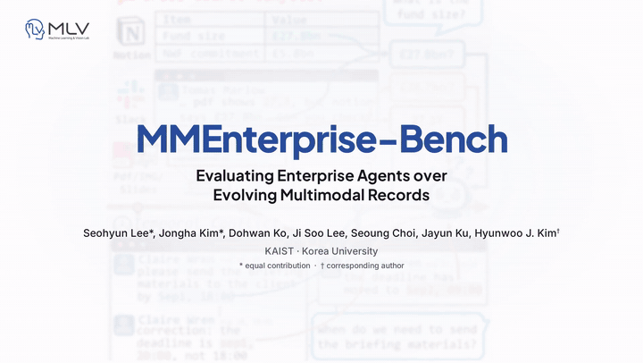

# MMEnterprise-Bench: Evaluating Enterprise Agents over Evolving Multimodal Records

  
  
  
  

**[Seohyun Lee](https://www.seohyunleee.com/)1,\* &nbsp;
[Jongha Kim](https://jonghakim35.github.io/)2,\* &nbsp;
[Dohwan Ko](https://ikodoh.github.io/)2 &nbsp;
[Ji Soo Lee](https://simplewhite9.github.io/)1 &nbsp;
[Seoung Choi](https://choisw0823.github.io)1 &nbsp;
Jayun Ku1 &nbsp;
[Hyunwoo J. Kim](https://www.hyunwoojkim.com/home)1,&dagger;**

1 KAIST &nbsp;&nbsp; 2 Korea University &nbsp;&nbsp;
(\* equal contribution &nbsp; &dagger; corresponding author)

 

  <a href="https://mlvlab.github.io/MMEnterprise-Bench/#video"><strong>▶ Watch the teaser video (2:23)</strong></a>
  &nbsp;·&nbsp;
  <a href="https://mlvlab.github.io/MMEnterprise-Bench/static/videos/mmenterprise-bench-teaser.mp4">Direct MP4</a>

> **TL;DR** — **MMEnterprise-Bench** is a QA benchmark over simulated company workspaces (Slack, email, Notion, meeting notes, slides, PDF pages, charts) whose records are revised and contradicted over time. It tests **evidence reasoning**, **cross-source and temporal conflict resolution**, and **unanswerability** for enterprise agents.

**1,613 questions** (1,526 answerable + 87 unanswerable) · **30 projects** · **7,140 records** (5,725 text + 1,415 visual) · **8 tasks** in 3 categories.

## News

- **2026-10** — Project page and teaser video are live.
- **Coming soon** — full generation pipeline code (seed PDF → simulated workspace → validated questions).
- **Coming soon** — dataset and evaluation toolkit (`mmeb`), with frozen retrieval rankings and the judge protocol.

The paper is under review; see the [project page](https://mlvlab.github.io/MMEnterprise-Bench/) for the task taxonomy, the construction pipeline and the main results.

## Results

Results (Table 5: accuracy %, 2B retriever)

Extr. = Extraction, Attr. = Attribution, Comp. = Computation, Cmpr. = Comparison, Interp. = Interpretation, Cross = Cross-source, Temp. = Temporal, Unans. = Unanswerability. Questions per column: 268 / 80 / 310 / 212 / 232 / 212 / 212 / 87 / 1,613.

**k = 10**

| Model | Extr. | Attr. | Comp. | Cmpr. | Interp. | Cross | Temp. | Unans. | **Overall** |
|---|---:|---:|---:|---:|---:|---:|---:|---:|---:|
| GPT-5.6 Sol | 67.5 | 61.3 | 58.1 | 47.2 | 58.6 | 36.3 | 32.5 | 65.5 | **52.6** |
| GPT-5.6 Luna | 66.4 | 57.5 | 55.5 | 44.8 | 58.2 | 35.4 | 33.5 | 63.2 | 51.3 |
| Gemini 3.8 Flash | 67.9 | 52.5 | 54.2 | 44.3 | 34.5 | 28.8 | 30.2 | 87.4 | 47.6 |
| Gemini 3.1 Pro | 66.8 | 58.8 | 54.8 | 42.5 | 30.6 | 27.4 | 28.8 | 74.7 | 45.9 |
| Qwen3.5-27B | 63.1 | 52.5 | 37.7 | 33.5 | 28.9 | 22.6 | 20.3 | 75.9 | 38.6 |
| Qwen3.5-9B | 60.1 | 40.0 | 36.5 | 25.9 | 27.2 | 14.2 | 21.2 | 73.6 | 34.9 |
| Qwen3.5-4B | 62.7 | 40.0 | 37.4 | 31.1 | 28.4 | 19.8 | 19.8 | 55.2 | 36.0 |
| Qwen3.5-2B | 58.6 | 20.0 | 21.9 | 17.9 | 12.9 | 12.7 | 13.2 | 19.5 | 23.6 |
| InternVL3.5-8B | 63.4 | 51.3 | 31.9 | 23.1 | 27.2 | 15.6 | 19.3 | 36.8 | 32.7 |
| Kimi-VL-16B-A3B-Instruct | 56.3 | 40.0 | 14.5 | 16.0 | 16.4 | 11.8 | 14.2 | 10.3 | 22.6 |

**k = 50**

| Model | Extr. | Attr. | Comp. | Cmpr. | Interp. | Cross | Temp. | Unans. | **Overall** |
|---|---:|---:|---:|---:|---:|---:|---:|---:|---:|
| GPT-5.6 Sol | 77.6 | 68.8 | 71.6 | 67.5 | 73.3 | 55.2 | 56.1 | 72.4 | **68.0** |
| GPT-5.6 Luna | 76.5 | 65.0 | 69.4 | 63.7 | 72.4 | 52.8 | 54.2 | 67.8 | 65.8 |
| Gemini 3.8 Flash | 78.0 | 71.3 | 71.6 | 65.6 | 53.4 | 46.7 | 54.2 | 74.7 | 63.9 |
| Gemini 3.1 Pro | 76.9 | 72.5 | 69.0 | 62.7 | 49.6 | 49.1 | 50.9 | 80.5 | 62.5 |
| Qwen3.5-27B | 73.9 | 56.3 | 50.3 | 43.9 | 42.7 | 35.8 | 38.7 | 71.3 | 50.3 |
| Qwen3.5-9B | 71.3 | 38.8 | 43.9 | 37.7 | 32.8 | 26.4 | 33.0 | 63.2 | 43.1 |
| Qwen3.5-4B | 69.8 | 43.8 | 48.7 | 42.9 | 35.3 | 26.4 | 30.2 | 47.1 | 43.8 |
| Qwen3.5-2B | 60.8 | 25.0 | 16.5 | 18.4 | 18.1 | 19.3 | 16.0 | 14.9 | 25.0 |
| InternVL3.5-8B | 66.4 | 53.8 | 35.5 | 28.8 | 31.0 | 24.1 | 23.1 | 29.9 | 36.6 |
| Kimi-VL-16B-A3B-Instruct | 57.5 | 35.0 | 12.6 | 19.3 | 19.4 | 15.6 | 9.9 | 13.8 | 23.1 |

Evidence Recall@k of the released retrievers (1,526 answerable questions): 2B 41.3 / 57.0 / 64.8, 8B 43.0 / 59.6 / 67.3 at k = 10 / 50 / 100. More results on the [project page](https://mlvlab.github.io/MMEnterprise-Bench/).

## License

Code will be released under the MIT License; benchmark annotations and simulated records under CC BY 4.0 (embedded figures and page images keep the rights of their source documents). The paper is an arXiv preprint; a BibTeX entry will be added once it is listed.
