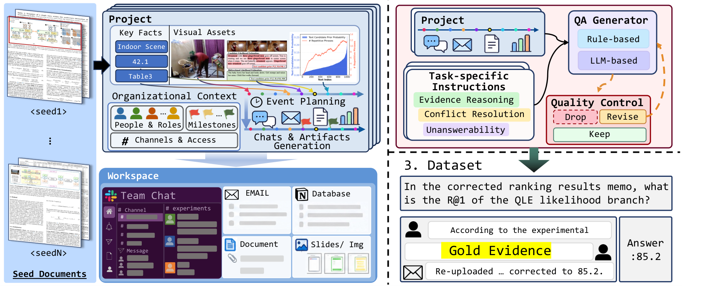

# MMEnterprise-Bench

**Evaluating Enterprise Agents over Evolving Multimodal Records**

[Project page](https://mlvlab.github.io/MMEnterprise-Bench/) · Paper (arXiv, coming soon) · [🤗 Dataset](https://huggingface.co/datasets/MMEnterprise-Bench/MMEnterprise-Bench) · [🤗 Baselines](https://huggingface.co/datasets/MMEnterprise-Bench/baselines)



MMEnterprise-Bench is a QA benchmark over simulated company workspaces (Slack, email, Notion, meeting notes, slides, PDF pages, charts) whose records are revised and contradicted over time. It tests evidence reasoning, cross-source and temporal conflict resolution, and unanswerability.

**1,613 questions** (1,526 answerable + 87 unanswerable) · **30 projects** · **7,140 records** (5,725 text + 1,415 visual) · **8 tasks** in 3 categories · frozen top-100 rankings from a 2B and an 8B retriever.

## Quick start

```bash
git clone https://github.com/mlvlab/MMEnterprise-Bench.git && cd MMEnterprise-Bench
pip install -e .      # Python >= 3.10
mmeb download         # -> data/MMEnterprise-Bench (230 MB, checksums verified)
```

## Evaluate your own agent

```bash
mmeb export-contexts --retriever 2b --k 10 --output contexts.jsonl   # 1. inputs (optional): the paper's retrieved records per question
# 2. run your agent and write predictions.jsonl: {"id": "p01::MU260919_03", "answer": "..."} per line
mmeb score predictions.jsonl --output outputs/my_agent               # 3. LLM-judge accuracy (OPENAI_API_KEY)
```

`examples/your_own_agent.py` is a fill-in template; `examples/openai_compatible_agent.py` is a complete agent for any OpenAI-compatible endpoint.

<details>
<summary>Prediction format and what the score means</summary>

One JSON object per question. `id` and `answer` (plain text) are required.

```json
{"id": "p01::MU260919_03", "answer": "Not recorded. The 07:30 comparison only reports R@1.", "retrieved_unit_ids": ["u00123", "u00456"]}
```

* `retrieved_unit_ids` (optional): corpus units your retriever returned; enables Evidence Recall of your retrieval.
* Accuracy = 100 × correct / **all 1,613 questions**. Missing questions count as incorrect (reported as `missing`); `observed_accuracy` covers only submitted ones.
* The judge (GPT-5.6 Luna, prompt in `mmenterprise_bench/prompts/judge_system.txt`) sees only the question, the reference answer and your answer. Judgments are cached, so re-runs are free.
* Outputs: `metrics.json`, `metrics.md`, `graded.jsonl`, with breakdowns per category, task, answerability, evidence modality and evidence count.
* `--pre-judged` re-aggregates files that already carry `correct` (for example the released baselines). `--limit N` is for smoke tests only.

</details>

<details>
<summary>Python API</summary>

```python
from mmenterprise_bench import load_dataset, build_context

ds = load_dataset()                                            # downloads on first use
for row in ds.rows:                                            # id, project, q, t, ...
    records = build_context(ds, row, retriever="2b", k=10)     # [{unit_id, record_id, timestamp, text, image_path, ...}]
    answer = my_agent(row["q"], records)                       # or search ds.units yourself
```

Context = first *k* hits of the released ranking, sorted chronologically, exactly as in the paper.

</details>

<details>
<summary>Another judge (vLLM, etc.) or no API key</summary>

```bash
mmeb score predictions.jsonl --judge-base-url http://127.0.0.1:8000/v1 --judge-model <served-model> --judge-api-key-env VLLM_API_KEY
```

Scores from a different judge are not directly comparable with the paper. To try the pipeline without any key:

```bash
python tests/mock_judge.py --port 8765 &
mmeb score examples/predictions_sample.jsonl --limit 20 --judge-base-url http://127.0.0.1:8765/v1 --judge-model mock
```

Full options: [EVALUATION.md](EVALUATION.md).

</details>

## Paper baselines

```bash
mmeb run-baseline --models luna --retrievers 2b --k 10     # resumable; OPENAI_API_KEY
```

Per-question outputs of all 10 models × 2 retrievers × k ∈ {10, 50, 100} are released at [🤗 Baselines](https://huggingface.co/datasets/MMEnterprise-Bench/baselines).

<details>
<summary>All readers, local models with vLLM, full grid</summary>

| Alias | Reader | Key / server |
| --- | --- | --- |
| `sol`, `luna` | GPT-5.6 Sol, GPT-5.6 Luna | `OPENAI_API_KEY` |
| `gemini38flash`, `gemini31pro` | Gemini 3.8 Flash, Gemini 3.1 Pro | `GEMINI_API_KEY` (+ `OPENAI_API_KEY` for the judge) |
| `qwen27b`, `qwen9b`, `qwen4b`, `qwen2b` | Qwen3.5 27B / 9B / 4B / 2B | local vLLM (`qwen27b`: 2 GPUs) |
| `internvl8b`, `kimivl16b` | InternVL3.5-8B, Kimi-VL-16B-A3B-Instruct | local vLLM |

```bash
pip install -e ".[local]"                                   # separate CUDA environment, vLLM 0.24.0
mmeb serve --model qwen4b --gpus 0 --port 8000               # pinned checkpoint revisions in mmenterprise_bench/configs/models.json
QWEN4B_BASE_URL=http://127.0.0.1:8000/v1 mmeb run-baseline --models qwen4b --retrievers 2b 8b --k 10 50 100
mmeb run-baseline --config mmenterprise_bench/configs/full_grid.json   # all 60 conditions
mmeb run-baseline --dry-run                                  # plan only
```

</details>

<details>
<summary>Results (Table 5: accuracy %, 2B retriever)</summary>

Extr. = Extraction, Attr. = Attribution, Comp. = Computation, Cmpr. = Comparison, Interp. = Interpretation, Cross = Cross-source, Temp. = Temporal, Unans. = Unanswerability. Questions per column: 268 / 80 / 310 / 212 / 232 / 212 / 212 / 87 / 1,613.

**k = 10**

| Model | Extr. | Attr. | Comp. | Cmpr. | Interp. | Cross | Temp. | Unans. | **Overall** |
|---|---:|---:|---:|---:|---:|---:|---:|---:|---:|
| GPT-5.6 Sol | 67.5 | 61.3 | 58.1 | 47.2 | 58.6 | 36.3 | 32.5 | 65.5 | **52.6** |
| GPT-5.6 Luna | 66.4 | 57.5 | 55.5 | 44.8 | 58.2 | 35.4 | 33.5 | 63.2 | 51.3 |
| Gemini 3.8 Flash | 67.9 | 52.5 | 54.2 | 44.3 | 34.5 | 28.8 | 30.2 | 87.4 | 47.6 |
| Gemini 3.1 Pro | 66.8 | 58.8 | 54.8 | 42.5 | 30.6 | 27.4 | 28.8 | 74.7 | 45.9 |
| Qwen3.5-27B | 63.1 | 52.5 | 37.7 | 33.5 | 28.9 | 22.6 | 20.3 | 75.9 | 38.6 |
| Qwen3.5-9B | 60.1 | 40.0 | 36.5 | 25.9 | 27.2 | 14.2 | 21.2 | 73.6 | 34.9 |
| Qwen3.5-4B | 62.7 | 40.0 | 37.4 | 31.1 | 28.4 | 19.8 | 19.8 | 55.2 | 36.0 |
| Qwen3.5-2B | 58.6 | 20.0 | 21.9 | 17.9 | 12.9 | 12.7 | 13.2 | 19.5 | 23.6 |
| InternVL3.5-8B | 63.4 | 51.3 | 31.9 | 23.1 | 27.2 | 15.6 | 19.3 | 36.8 | 32.7 |
| Kimi-VL-16B-A3B-Instruct | 56.3 | 40.0 | 14.5 | 16.0 | 16.4 | 11.8 | 14.2 | 10.3 | 22.6 |

**k = 50**

| Model | Extr. | Attr. | Comp. | Cmpr. | Interp. | Cross | Temp. | Unans. | **Overall** |
|---|---:|---:|---:|---:|---:|---:|---:|---:|---:|
| GPT-5.6 Sol | 77.6 | 68.8 | 71.6 | 67.5 | 73.3 | 55.2 | 56.1 | 72.4 | **68.0** |
| GPT-5.6 Luna | 76.5 | 65.0 | 69.4 | 63.7 | 72.4 | 52.8 | 54.2 | 67.8 | 65.8 |
| Gemini 3.8 Flash | 78.0 | 71.3 | 71.6 | 65.6 | 53.4 | 46.7 | 54.2 | 74.7 | 63.9 |
| Gemini 3.1 Pro | 76.9 | 72.5 | 69.0 | 62.7 | 49.6 | 49.1 | 50.9 | 80.5 | 62.5 |
| Qwen3.5-27B | 73.9 | 56.3 | 50.3 | 43.9 | 42.7 | 35.8 | 38.7 | 71.3 | 50.3 |
| Qwen3.5-9B | 71.3 | 38.8 | 43.9 | 37.7 | 32.8 | 26.4 | 33.0 | 63.2 | 43.1 |
| Qwen3.5-4B | 69.8 | 43.8 | 48.7 | 42.9 | 35.3 | 26.4 | 30.2 | 47.1 | 43.8 |
| Qwen3.5-2B | 60.8 | 25.0 | 16.5 | 18.4 | 18.1 | 19.3 | 16.0 | 14.9 | 25.0 |
| InternVL3.5-8B | 66.4 | 53.8 | 35.5 | 28.8 | 31.0 | 24.1 | 23.1 | 29.9 | 36.6 |
| Kimi-VL-16B-A3B-Instruct | 57.5 | 35.0 | 12.6 | 19.3 | 19.4 | 15.6 | 9.9 | 13.8 | 23.1 |

Evidence Recall@k of the released retrievers (1,526 answerable questions): 2B 41.3 / 57.0 / 64.8, 8B 43.0 / 59.6 / 67.3 at k = 10 / 50 / 100. More results on the [project page](https://mlvlab.github.io/MMEnterprise-Bench/).

</details>

## Dataset

```python
from datasets import load_dataset
questions = load_dataset("MMEnterprise-Bench/MMEnterprise-Bench", "questions", split="test")   # 1,613 rows
corpus    = load_dataset("MMEnterprise-Bench/MMEnterprise-Bench", "corpus", split="test")      # 7,140 rows, `image` column
```

<details>
<summary>Files and schema</summary>

`mmeb download` fetches the raw layout used by the evaluator; the same data is on the Hub as parquet configs `questions`, `corpus`, `retrieval_2b`, `retrieval_8b`, `projects`, `seed_documents`.

```text
data/MMEnterprise-Bench/
├── qa/rows.json            # 1,613 questions: id, project, q, gold.answer, task, category, evidence, solution, ...
├── corpus/units.json       # 7,140 records: id, record_id, text, image, timestamp, order, ...
├── retrieval/              # ranks_2b.json / ranks_8b.json: top-100 hits per question
├── media/                  # 1,415 original images
├── projects.json · seed_documents.json · manifest.json · SHA256SUMS
```

Field definitions: [data/SCHEMA.md](data/SCHEMA.md). Counts, taxonomy and source documents: [data/README.md](data/README.md). `mmeb validate` checks a local copy.

</details>

## Generate new projects

```bash
pip install -e ".[generate]"
./run_project.bash            # seed PDF -> simulated project -> validated questions (OPENAI_API_KEY; resumable)
```

<details>
<summary>Details</summary>

The default config (`data_generation_pipeline/config.json`) uses the bundled NIST CSF 2.0 PDF; point `seed_pdf` at any other document. Stages, QA families and outputs are described in [data_generation_pipeline/README.md](data_generation_pipeline/README.md). `./run_project.bash --dry-run` prints the stage plan. Generated projects are new simulations; the released benchmark is the fixed snapshot on the Hub.

</details>

<details>
<summary>Repository layout, checks and tests</summary>

```text
mmenterprise_bench/          # `mmeb` package: download, validate, export-contexts, score, run-baseline, metrics, serve
examples/                    # your_own_agent.py, openai_compatible_agent.py, predictions_sample.jsonl
scripts/                     # bash wrappers, check.bash, release tooling (hf/)
tests/                       # unit tests + mock_judge.py
data/                        # README.md, SCHEMA.md, validate.py (dataset itself is downloaded, git-ignored)
data_generation_pipeline/    # seed PDF -> simulated project -> validated questions
docs/                        # project page
EVALUATION.md                # detailed evaluation guide
```

```bash
bash scripts/check.bash               # offline checks (no API key); also runs in CI
python -m unittest discover -s tests
```

</details>

## License

Code: [MIT](LICENSE). Benchmark annotations and simulated records: CC BY 4.0; embedded figures and page images keep the rights of their source documents (listed in `seed_documents.json`). The paper is an arXiv preprint; a BibTeX entry will be added once it is listed.
